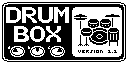
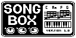

# Custom Zoom ZDL effects

Custom effects (ZDL) for Zoom pedals of the MultiStomp / G1on / B1on family.

| Effect | Screen | Category | What it is | Demo | Download |
|---|---|---|---|---|---|
| [DrumBox](src/drumbox/README.md) | <a href="src/drumbox/README.md"></a> | SFX | Drum machine: 150 beats, 150 fills, 22 kits, songs of two sections | [Video](https://www.youtube.com/watch?v=9CBZu1qY9KA "DrumBox: a custom drum machine effect for Zoom pedals that load ZDL effects") | [Releases](../../releases) |
| [SongBox](src/songbox/README.md) (0.7 beta) | <a href="src/songbox/README.md"></a> | SFX | Chord song sequencer: songs of up to 128 bars written on the pedal, two organs, electric piano, marimba, kalimba, synth and pluck chords with five basses (48 kits), drives DrumBox. Needs Floppy | — | — |
| [Floppy](src/floppy/README.md) | <a href="src/floppy/README.md"></a> | SFX | Silent storage effect: saves SongBox's song in the patch | — | — |

More effects will follow.

## Pedals

These pedals use the ZDL effect format (`.ZDL` files):

| Pedal | Firmware | DrumBox | SongBox + Floppy |
|---|----------|---|---|
| Zoom G1Xon | 1.21     | **Works** (all features tested) | Untested (same OS as the B1Xon) |
| Zoom G1on | —        | Untested | Untested |
| Zoom B1on | —        | Untested | Untested |
| Zoom B1Xon | 1.30     | **Works** (all features tested) | **Works** (one Floppy; several copies untested) |
| Zoom MS-70CDR | 2.10     | Untested; the toolchain's main target (other custom ZDLs run on it) | Untested |
| Zoom MS-50G | 3.10     | Untested | Untested |
| Zoom MS-60B | 2.10     | Untested | Untested |

Not supported: the newer pedals that use `.ZD2` effects instead of ZDL
(MS-50G+, MS-60B+, MS-70CDR+, G1Four / G1XFour, B1Four / B1XFour,
A1Four / A1XFour, G3n / G3Xn, G5n, B3n, ...).

Reports for other pedals are welcome. Please open an issue with the
pedal, firmware and what happened.

> **Use at your own risk.** Custom effects run code on the pedal's DSP. A
> bad effect can freeze the pedal when it is selected; power-cycle it and
> delete the effect. Keep a backup of your pedal's effects before
> installing anything.
> This project is not affiliated with or endorsed by Zoom.

## Install

Download an effect's `.ZDL` from the [Releases](../../releases) page
(DrumBox is also in `dist/`). Each effect's README gives its category and how many free
flash blocks it needs.

Install it like any other effect with
[Zoom Effect Manager 2](https://zoomeffectmanager.com/en/): add the
ZDL to its custom folder and write it to the pedal. Or you can still use
my old Zoom Firmware Editor: add the ZDL to the pedal's firmware updater
file and run the updater.

## Building

You only need this to change an effect.

- **TI C6000 Code Generation Tools:** the standalone 8.3.15
  ([ti.com/tool/C6000-CGT](https://www.ti.com/tool/C6000-CGT)) or 8.5.0.LTS
  from Code Composer Studio 20.x. `build.py` looks at `TI_CGT_ROOT`, then at
  `C:/ti/...`.
- **Python 3.8+** with Pillow; numpy only for fitting new drum samples.

```
pip install -r requirements.txt
```

Each effect has its own `build.py`; see its README for the commands.

| Path | What |
|---|---|
| `src/drumbox/` | DrumBox: DSP (`drumbox.c`), beats and fills (`patterns/patterns.json`), kits (`kits.py`), drums (`drums/`), build and preview scripts |
| `src/songbox/` | SongBox: DSP (`songbox.c`), patterns (`patterns/patterns.json`), song packer (`packer/`), instruments (`instruments/`, `sets.py`) |
| `src/floppy/` | Floppy: the storage effect that saves zmenu effects' data in the patch |
| `src/common/zmenu/` | zmenu: C library for knob menus and data saved through Floppy (`zmenu.h`), layout generator (`zmenu_gen.py`) |
| `build/` | The linker that turns the TI object file into a ZDL, based on repeat98's, with additions (see its header); shared build helpers (`zdl_build.py`) |
| `tools/` | Experimental G1Xon USB file transfer, used during development (not for general use yet) |
| `docs/HARDWARE-NOTES.md` | What was learned on the hardware: load limit, `_init`, knob ranges, DSP load, ... |
| `docs/CROSS-PEDAL-ZDL-SUMMARY.md` | What one ZDL needs to run on both the MS pedals and the G1on family |
| `docs/ZDL-SIZE-TIPS.md` | What made our ZDLs smaller (flash and load limit), with measured savings |
| `docs/ZDL-CPU-TIPS.md` | What made our effects cheaper to run (load probes, pipelined loops, work spread over calls), measured |
| `dist/` | The current builds of the effects |

## Inspiration and documentation

These effects stand on the work of these projects:

- [repeat98/ZoomMultistompZDL](https://github.com/repeat98/ZoomMultistompZDL):
  a ZDL toolchain (TI compiler + reverse-engineered Python linker) with ABI
  documentation and Airwindows ports for the MS-70CDR.
- [themanro/ZoomMultistompZDL](https://github.com/themanro/ZoomMultistompZDL):
  a fork of repeat98's toolchain with many custom effects and a browser
  patch editor that also installs effects over USB.
- [ELynx/zoom-fx-modding](https://github.com/ELynx/zoom-fx-modding): early
  ZDL reverse engineering (format, screen images, DSP loop) and the first
  hand-written custom effects.
- [ELynx/zoom-fx-compressed](https://github.com/ELynx/zoom-fx-compressed):
  Zoom's stock effects with debug info stripped, so they take less flash.
- [matujuice/zoom-ms-zdl-effects-pack](https://github.com/matujuice/zoom-ms-zdl-effects-pack):
  custom effects for synthesizer use on MS pedals.
- [matujuice/zoom-ms-midistomp](https://github.com/matujuice/zoom-ms-midistomp):
  custom firmware for MS pedals that adds MIDI control and MIDI clock.
- [Leemuzhko/HYBRID-IR](https://github.com/Leemuzhko/HYBRID-IR): a desktop
  app that makes cabinet IR effects from WAV impulse responses without the
  TI compiler.
- [Leemuzhko/Zoom-ZDL-FX](https://github.com/Leemuzhko/Zoom-ZDL-FX):
  ready-made ZDL effects (IR cabinets, IR loaders, amps, a synth).
- [zisonzishen0415-stack/b1on-firmware-reverse](https://github.com/zisonzishen0415-stack/b1on-firmware-reverse):
  B1on / G1on firmware reverse engineering, with a Ghidra module for the
  C6000 DSP.
- [shooking/ZoomPedalFun](https://github.com/shooking/ZoomPedalFun): tips,
  SysEx scripts and tools for many Zoom pedals.
- [mungewell/zoom-zt2](https://github.com/mungewell/zoom-zt2): effect list
  editing and file transfer for the newer (ZD2) Zoom pedals.
- [thammer/stomphacks](https://github.com/thammer/stomphacks): a C-to-ZD2
  pipeline for custom effects on the MS Plus pedals.
- [Ziddle](https://berbasoft.com/ziddle/): an emulator that runs ZDL and ZD2
  effects, with readers for Zoom's file formats and firmware images.

## Licence

MIT, see [LICENSE](LICENSE). Third-party code and the LineSel handler blob
are listed in [THIRD_PARTY.md](THIRD_PARTY.md).
