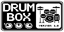

# Custom Zoom ZDL effects

Custom effects (ZDL) for Zoom pedals of the MultiStomp / G1on / B1on family.

| Effect | Screen | Category | What it is | Demo | Download |
|---|---|---|---|---|---|
| [DrumBox](drumbox/README.md) | <a href="drumbox/README.md"></a> | SFX | Drum machine: 150 beats, 150 fills, 22 kits, songs of two sections | [Video](https://www.youtube.com/watch?v=9CBZu1qY9KA "DrumBox: a custom drum machine effect for Zoom pedals that load ZDL effects") | [Releases](../../releases) |

More effects will follow.

## Pedals

These pedals use the ZDL effect format (`.ZDL` files):

| Pedal | Firmware | DrumBox |
|---|---|---|
| Zoom G1Xon | 1.21 | **Works** (all features tested) |
| Zoom G1on | — | Untested |
| Zoom B1on | — | Untested |
| Zoom B1Xon | 1.21 | **Works** (all features tested) |
| Zoom MS-70CDR | 2.10 | Untested; the toolchain's main target (other custom ZDLs run on it) |
| Zoom MS-50G | — | Untested |
| Zoom MS-60B | — | Untested |

Not supported: the newer pedals that use `.ZD2` effects instead of ZDL
(MS-50G+, MS-60B+, MS-70CDR+, G1Four / G1XFour, B1Four / B1XFour,
A1Four / A1XFour, G3n / G3Xn, G5n, B3n, ...).

Reports for other pedals are welcome. Please open an issue with the
pedal, firmware and what happened.

> **Use at your own risk.** Custom effects run code on the pedal's DSP. A
> bad effect can freeze the pedal when it is selected; power-cycle it and
> delete the effect. Keep a backup of your pedal's effects before
> installing anything.
> This project is not affiliated with or endorsed by Zoom.

## Install

Download an effect's `.ZDL` from the [Releases](../../releases) page (or
use `dist/`). Each effect's README gives its category and how many free
flash blocks it needs.

Install it like any other effect with
[Zoom Effect Manager 2](https://zoomeffectmanager.com/en/): add the
ZDL to its custom folder and write it to the pedal. Or you can still use
my old Zoom Firmware Editor: add the ZDL to the pedal's firmware updater
file and run the updater.

## Building

You only need this to change an effect.

- **TI C6000 Code Generation Tools:** the standalone 8.3.15
  ([ti.com/tool/C6000-CGT](https://www.ti.com/tool/C6000-CGT)) or 8.5.0.LTS
  from Code Composer Studio 20.x. `build.py` looks at `TI_CGT_ROOT`, then at
  `C:/ti/...`.
- **Python 3.8+** with Pillow; numpy only for fitting new drum samples.

```
pip install -r requirements.txt
```

Each effect has its own `build.py`; see its README for the commands.

| Path | What |
|---|---|
| `drumbox/` | DrumBox: DSP (`drumbox.c`), beats and fills (`patterns.py`), kits (`kits.py`), drums (`drums/`), build and preview scripts |
| `build/` | The linker that turns the TI object file into a ZDL, based on repeat98's, with additions (see its header) |
| `tools/` | Experimental G1Xon USB file transfer, used during development (not for general use yet) |
| `docs/HARDWARE-NOTES.md` | What was learned on the hardware: load limit, `_init`, knob ranges, DSP load, ... |
| `dist/` | The current builds of the effects |

## Inspiration and documentation

These effects stand on the work of these projects:

- [repeat98/ZoomMultistompZDL](https://github.com/repeat98/ZoomMultistompZDL):
  the reverse-engineered ZDL ABI and the Python linker this build is based on.
- [themanro/ZoomMultistompZDL](https://github.com/themanro/ZoomMultistompZDL):
  the materializing `_init` (saved knob values on patch load), effects and a
  patch editor.
- [ELynx/zoom-fx-modding](https://github.com/ELynx/zoom-fx-modding): the
  first public documentation of the ZDL format, screen images and the DSP
  buffer layout.
- [ELynx/zoom-fx-compressed](https://github.com/ELynx/zoom-fx-compressed):
  stripped stock effects that free flash space.
- [matujuice/zoom-ms-zdl-effects-pack](https://github.com/matujuice/zoom-ms-zdl-effects-pack)
  and [matujuice/zoom-ms-midistomp](https://github.com/matujuice/zoom-ms-midistomp):
  synth-oriented effects and MIDI clock firmware for MS pedals.
- [Leemuzhko/HYBRID-IR](https://github.com/Leemuzhko/HYBRID-IR) and
  [Leemuzhko/Zoom_FX_Project](https://github.com/Leemuzhko/Zoom_FX_Project):
  cabinet IR effects without the TI compiler, knob display callbacks.
- [zisonzishen0415-stack/b1on-firmware-reverse](https://github.com/zisonzishen0415-stack/b1on-firmware-reverse):
  G1on / B1on firmware reverse engineering, including the DSP cost budget.
- [shooking/ZoomPedalFun](https://github.com/shooking/ZoomPedalFun): SysEx
  tips and tools for many Zoom pedals.
- [mungewell/zoom-zt2](https://github.com/mungewell/zoom-zt2): effect list and
  file transfer for the newer Zoom pedals.
- [thammer/stomphacks](https://github.com/thammer/stomphacks): custom
  effects for the MS Plus pedals.

## Licence

MIT, see [LICENSE](LICENSE). Third-party code and the LineSel handler blob
are listed in [THIRD_PARTY.md](THIRD_PARTY.md).
