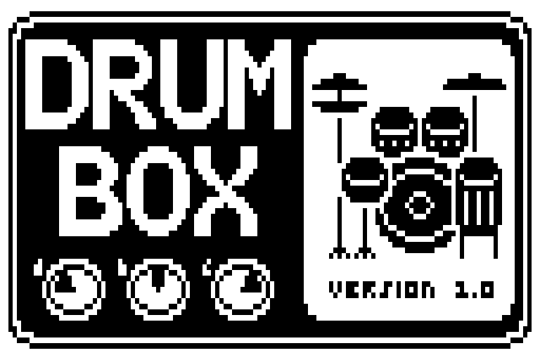

# DrumBox — drum machine ZDL for Zoom pedals



Eight drum lanes (kick, snare, closed hat, open hat, ride, crash, high tom,
low tom) playing 150 one-bar beats with 150 fills on top (Random included),
in 22 kits.

- **Footswitch on:** the song starts on section A, beat 1. **Off:** it stops.
- The guitar passes through at full level, mixed with the drums.
- Category SFX (gid 7), fxid 520 (0x208), file `DrumBox.ZDL`.

How it works:

- **Drums** come from a palette in `drums/`, one file per drum, of two
  kinds (a kit can mix both):
  - **sampled drums**, resynthesized from WAV samples: `drum_analyze.py`
    turns each sample into partials + noise-band envelopes, and the DSP
    plays that data back;
  - **synth drums**, each with its own C code and parameters.
- **Fills** with toms go down the kit: high tom first, then low tom.
- **State** lives in the effect's `ctx[3]` memory.
- **Build:** the linker in `../build/` (based on repeat98's).

## Controls

| Page | Knob | Range | Meaning |
|---|---|---|---|
| 1 | BeatA | 0–150 | Section A (verse) beat (default Rock4) |
| 1 | FillA | 0–150 | Fill on section A's last bar (default Sn1) |
| 1 | LenA | 0–13 | Section A length (default 8BarM) |
| 2 | BeatB | 0–150 | Section B (chorus) beat (default Funk) |
| 2 | FillB | 0–150 | Fill on section B's last bar (default Randm) |
| 2 | LenB | 0–13 | Section B length (default 8BarM) |
| 3 | Tempo | 0–200 | **BPM = 40 + knob** (1 BPM steps, 80 = 120 BPM) |
| 3 | Volume | 0–100 | Drum level |
| 3 | Kit | 0–21 | Drum kit, one step per kit (see Kits) |

- **Beat and fill knobs:** one step per entry, the screen shows the short
  name (lists below). 0 = None, 1 = Randm (random).
- **Length knobs:** Skip, 1Bar, 2Bar, 2BarM, 4Bar, 4BarM, 8Bar, 8BarM,
  16Bar, 16BrM, 32Bar, 32BrM, 64Bar, 64BrM. M = the fill also plays in the
  middle of the section; Skip = the section is not played (see Song).
- **Tempo** shows the BPM (40…240) on the screen.
- **Accents** are fixed: hits on a beat's accent steps play at full level,
  the others at 0.72.

How the knobs work inside:

- The DSP gets raw = knob value / 100, whatever the knob's max, so each
  beat, fill, length and kit gets exactly one knob step. `build.py` sets
  the knob maxes from `patterns.py` and `kits.py`.
- All knobs but Volume show text through display callbacks (`"getstr"` in
  the manifest → `GetString_Db*` in `drumbox.c`; the two beat, fill and
  length knobs share one callback each).

### Song

The sequencer plays a song of two sections in turn, then starts again
with section A:

| Section | Plays | Fill |
|---|---|---|
| A (verse) | BeatA for LenA bars | FillA on its last bar |
| B (chorus) | BeatB for LenB bars | FillB on its last bar |

Defaults: Rock4 for 8BarM with Sn1, then Funk for 8BarM with Randm.

**Lengths**

- **Skip** leaves the section out: the other section loops on its own,
  with its fill on its own last bar. Both on Skip = no drums.
- **1Bar**: every bar of the section is a fill bar.
- **M entries** (2BarM … 64BrM) also play the section's fill on the last
  bar of its first half: 4BarM = A, A+F, A, A+F; 2BarM = A+F, A+F. Randm
  picks a new fill there too.

**Fills**

- A fill covers the bar from its start step to the end. Lanes it replaces
  drop the beat's hits there; other lanes keep the beat and add the
  fill's hits.
- Beats have no crash: the crash comes with the fills. **Crash fills**
  (Crash column in the fill tables) end on a crash on beat 1 of the next
  bar: FillA on the chorus's first bar, FillB on the verse's first bar
  (also when the footswitch starts the song).
- A crash fill crashes at most every 4th bar, and never after a middle
  fill (M lengths).
- The light fills (pickups, open hats, half-beat rolls, hats only, hits,
  ride swap, half / double time, stops) have no crash: pick one of those
  to play without one.

**Knob changes** take effect at the next bar line. A shorter Length that
the section has already passed ends the section there.

### Beats

Swing comes with the beat: `sw16` = light 16th swing (~1.4:1), `sw16h` =
heavy 16th swing (~1.7:1), `tri8` = triplet 8th shuffle (2:1); the others
are straight. A fill plays with its beat's swing.

**Basic**

| Knob | Screen | Beat | Swing |
|---|---|---|---|
| 0 | None | None (no beat: only the fills play, over silence) |  |
| 1 | Randm | Random (a random beat, any of the 149 below; a new one every time its section starts and when the knob is turned to it) |  |
| 2 | Metro | Metronome |  |

**Rock / pop**

| Knob | Screen | Beat | Swing |
|---|---|---|---|
| 3 | Rock | Rock |  |
| 4 | Rock2 | Rock 2 |  |
| 5 | Rock3 | Rock 3 |  |
| 6 | Rock4 | Rock 4 |  |
| 7 | Rk16 | Rock 16ths |  |
| 8 | Rk16b | Rock 16ths 2 |  |
| 9 | SyncR | Syncopated Rock |  |
| 10 | 4Flr | Four-Floor Rock |  |
| 11 | Drive | Driving 8ths |  |
| 12 | HRock | Hard Rock |  |
| 13 | HRk2 | Hard Rock 2 |  |
| 14 | RRock | Ride Rock |  |
| 15 | RdFlr | Ride Floor |  |
| 16 | OHRk | Open-Hat Rock |  |
| 17 | Balld | Ballad |  |
| 18 | SlowR | Slow Rock |  |
| 19 | RdBal | Ride Ballad |  |
| 20 | PwrBd | Power Ballad |  |
| 21 | Pop2 | Pop 2 |  |
| 22 | Pop3 | Pop 3 |  |
| 23 | PopRk | Pop Rock |  |
| 24 | PopR2 | Pop Rock 2 |  |
| 25 | PwrPp | Power Pop |  |
| 26 | PBald | Pop Ballad |  |
| 27 | Pop16 | Pop 16ths |  |
| 28 | PSw16 | Pop 16ths Swing | sw16 |
| 29 | PopGr | Pop Groove 16 |  |
| 30 | PShuf | Pop Shuffle | tri8 |
| 31 | DncPp | Dance Pop |  |
| 32 | Motwn | Motown |  |
| 33 | SoftR | Soft Rock |  |
| 34 | FolkR | Folk Rock |  |
| 35 | FStmp | Folk Stomp |  |
| 36 | ClRk | Classic Rock |  |
| 37 | 80sRk | 80s Rock |  |
| 38 | South | Southern Rock |  |
| 39 | Indie | Indie Rock |  |
| 40 | AltRk | Alt Rock |  |
| 41 | Garag | Garage Rock |  |
| 42 | Glam | Glam Stomp |  |
| 43 | Stomp | Stadium Stomp |  |
| 44 | HTRk | Half-Time Rock |  |
| 45 | HTShf | Half-Time Shuffle | tri8 |
| 46 | FastR | Fast Rock |  |
| 47 | Prog | Prog Rock |  |
| 48 | Punk | Punk |  |
| 49 | DBeat | D-Beat |  |
| 50 | PopPk | Pop Punk |  |
| 51 | HCore | Hardcore |  |
| 52 | PostP | Post-Punk |  |
| 53 | NWave | New Wave |  |
| 54 | Grung | Grunge |  |
| 55 | Shufl | Shuffle | tri8 |
| 56 | Boogi | Boogie | tri8 |
| 57 | Rkbly | Rockabilly | tri8 |
| 58 | Surf | Surf Toms |  |
| 59 | BoDid | Bo Diddley |  |
| 60 | TomGr | Tom Groove |  |
| 61 | FlTom | Floor Tom Rock |  |
| 62 | FlHat | Floor Tom + Hats |  |
| 63 | Train | Train Beat |  |
| 64 | TrSwg | Train Swing | sw16 |
| 65 | Motor | Motorik |  |

**Metal**

| Knob | Screen | Beat | Swing |
|---|---|---|---|
| 66 | Metal | Metal |  |
| 67 | Thrsh | Thrash |  |
| 68 | Blast | Blast Beat |  |
| 69 | Galop | Gallop |  |
| 70 | Djent | Djent |  |
| 71 | HTMtl | Half-Time Metal |  |
| 72 | Brkdn | Breakdown |  |

**Funk / soul**

| Knob | Screen | Beat | Swing |
|---|---|---|---|
| 73 | Funk | Funk |  |
| 74 | SwFnk | Swung Funk | sw16 |
| 75 | Funk2 | Funk 2 |  |
| 76 | FDrum | Funky Drummer |  |
| 77 | Strut | Strut |  |
| 78 | GoGo | Go-Go |  |
| 79 | NOLA | New Orleans |  |
| 80 | Purdy | Purdie Shuffle | tri8 |
| 81 | LinFk | Linear Funk |  |

**Disco / dance / electronic**

| Knob | Screen | Beat | Swing |
|---|---|---|---|
| 82 | Disco | Disco |  |
| 83 | DeepH | Deep House |  |
| 84 | SwHse | Swing House | sw16 |
| 85 | Minml | Minimal |  |
| 86 | Techn | Techno |  |

**Breaks**

| Knob | Screen | Beat | Swing |
|---|---|---|---|
| 87 | Break | Breakbeat |  |
| 88 | Amen | Amen |  |
| 89 | Think | Think Break |  |
| 90 | Apach | Apache |  |
| 91 | Impch | Impeach |  |
| 92 | Levee | Levee Break |  |
| 93 | CSwet | Cold Sweat |  |
| 94 | RollB | Rolling Break |  |
| 95 | BrkB2 | Breakbeat 2 |  |
| 96 | HHBrk | Hip-Hop Break |  |
| 97 | BrkRd | Breakbeat Ride |  |
| 98 | NuSkl | Nu Skool Breaks |  |
| 99 | HTBrk | Half-Time Break |  |

**Big beat**

| Knob | Screen | Beat | Swing |
|---|---|---|---|
| 100 | BigB1 | Big Beat |  |
| 101 | BigB2 | Big Beat 2 |  |
| 102 | BBShf | Big Beat Shuffle | sw16h |
| 103 | BBTom | Big Beat Toms |  |

**Drum and bass / garage**

| Knob | Screen | Beat | Swing |
|---|---|---|---|
| 104 | DnB | Drum and Bass |  |
| 105 | Jungl | Jungle |  |
| 106 | Dubst | Dubstep |  |
| 107 | 2Step | 2-Step Garage |  |
| 108 | 2StSw | 2-Step Swing | sw16h |

**Hip-hop / R&B**

| Knob | Screen | Beat | Swing |
|---|---|---|---|
| 109 | BBap | Boom Bap |  |
| 110 | BBap2 | Boom Bap 2 |  |
| 111 | BBpSw | Boom Bap Swing | sw16 |
| 112 | LoFi | Lo-Fi |  |
| 113 | LoFiS | Lo-Fi Swing | sw16 |
| 114 | Half | Half Time |  |
| 115 | Drill | Drill |  |
| 116 | Trap | Trap |  |
| 117 | NJack | New Jack Swing |  |
| 118 | NeoSl | Neo Soul |  |
| 119 | Dilla | Dilla | sw16h |

**Latin**

| Knob | Screen | Beat | Swing |
|---|---|---|---|
| 120 | Songo | Songo |  |
| 121 | Bolro | Bolero |  |
| 122 | Cumbi | Cumbia |  |
| 123 | Rgtn | Reggaeton |  |
| 124 | Baiao | Baiao |  |
| 125 | Tango | Tango |  |
| 126 | Calyp | Calypso |  |
| 127 | Samba | Samba |  |
| 128 | Bossa | Bossa Nova |  |

**Reggae / ska**

| Knob | Screen | Beat | Swing |
|---|---|---|---|
| 129 | 1Drop | One Drop |  |
| 130 | Rckrs | Rockers |  |
| 131 | Stepr | Steppers |  |
| 132 | Ska | Ska |  |
| 133 | Dub | Dub |  |

**Swing / jazz / country**

| Knob | Screen | Beat | Swing |
|---|---|---|---|
| 134 | Swing | Swing | tri8 |
| 135 | Bebop | Bebop | tri8 |
| 136 | Jazz4 | Jazz 4 | tri8 |
| 137 | Texas | Texas Shuffle | tri8 |
| 138 | Blues | Blues | tri8 |
| 139 | Cntry | Country |  |
| 140 | CnShf | Country Shuffle | tri8 |
| 141 | March | March |  |

**World**

| Knob | Screen | Beat | Swing |
|---|---|---|---|
| 142 | Afro | Afrobeat |  |
| 143 | Bhang | Bhangra |  |
| 144 | Maqsm | Maqsum |  |

**Building blocks**

| Knob | Screen | Beat | Swing |
|---|---|---|---|
| 145 | SnRol | Snare Roll |  |
| 146 | Hats | Hats Only |  |
| 147 | Shakr | Offbeat Shaker |  |
| 148 | Kick | Kick Only |  |
| 149 | KSnr | Kick and Snare |  |
| 150 | Stop | Stop |  |

### Fills

Most fills come in lengths: **h** = last half beat, **1** = last beat,
**2** = last two beats, **4** = the whole bar. Crash = crash fill (a crash on the next downbeat).
The family table explains the fills; the tables after it list every fill
in knob order.

| Family | Fill |
|---|---|
| Sp1–Sp3 | Snare pickups added to the groove (last 16th, two 16ths, 2-and + 4) |
| Kp1–Kp3 | Kick pickups / push added to the groove |
| OHp, OH1, OH2, OH4 | Open hat on the last offbeat, or open hats on every offbeat |
| Lp1, Tp2, SLp | Light pickups: low tom, high + low tom, snare + low tom |
| Sn | Snare 16th roll (A's kick stays under it) |
| S8, Fl, Tr | Snare 8ths, doubles (xx..), 3-3-2 figure |
| SC, Bd | Snare crescendo (8ths then 16ths), build-up (quarters → 8ths → 16ths, accented end) |
| Rl, KS | Kick on the beat + snare roll, kick+snare unison 8ths |
| Bn | Bonham triplets: snare, tom, kick in groups of three 16ths (toms high, then low) |
| Ln, KT | Linear kick-snare-tom-snare 16ths, kick+tom unison 8ths |
| Tm, T8, TC, Tt | Tom 16ths, tom 8ths, tom crescendo, tom 3-3-2 |
| HL, SL | High/low tom alternating 16ths, snare/low tom alternating 16ths |
| Gl | Tom gallop (x.xx), high then low |
| LK | Kick + low tom unison 8ths |
| TK | Kick on the beat + tom roll |
| ST, TS, Mx, Al | Snare → tom, tom → snare, snare/tom mix, snare/tom alternating 16ths |
| Sx4 | Snare 16ths for three beats, then down the toms |
| Cs | Down the kit: snare, toms, kick |
| Ak | Around the kit: snare, high tom, then low tom |
| SnF, MixF, RkFil, RkFl2, TomFl, Build, AmenB | Fills from the old 2-bar patterns (bar B) |
| Hit, Sy | Kick + snare + crash on every beat, or on a 3-3-2 syncopation |
| KD | Double kick |
| Hat | Drop to hats only |
| Rd | Switch to ride 8ths |
| RdBld | Ride build: ride 8ths, then 16ths over kick pushes (last two beats) |
| Ht, Dt | Half-time / double-time feel |
| Push | Kick + crash on the last 8th (anticipates the next bar), then silence |
| Gh, Ch, KK | Ghost-note snare roll, break chop (kick/snare cut-up), kick/snare alternating 16ths |
| BB | Big beat roll: snare 16ths, kick quarters, open hats on the offbeats |
| Dk, Dh | Drops: kick only, or the beat without its snare |
| AmCh, FDFil, Stab | Amen chop, Funky Drummer fill, big-beat kick + snare + crash stabs |
| Stp | Stop: kick + crash, then silence |
| Brk | Break: silence |
| BP | Break, then a snare pickup on the last beat |

**Basic**

| Knob | Screen | Fill | Crash |
|---|---|---|---|
| 0 | None | None (no fill: the beat plays on) |  |
| 1 | Randm | Random (a different fill each time, any of the 139 before Stp1) |  |

**Pickups and open hats**

| Knob | Screen | Fill | Crash |
|---|---|---|---|
| 2 | Sp1 | Snare pickup |  |
| 3 | Sp2 | Snare pickup x2 |  |
| 4 | Sp3 | Snare pickups 2-and |  |
| 5 | Kp1 | Kick pickup |  |
| 6 | Kp2 | Kick pickup x2 |  |
| 7 | Kp3 | Kick push |  |
| 8 | OHp | Open hat end |  |
| 9 | OH1 | Open hats 4 |  |
| 10 | OH2 | Open hats 2 |  |
| 11 | OH4 | Open hats bar |  |
| 12 | Lp1 | Low tom pickup |  |
| 13 | Tp2 | Tom pickups |  |
| 14 | SLp | Snare + low tom pickup |  |

**Snare rolls**

| Knob | Screen | Fill | Crash |
|---|---|---|---|
| 15 | Snh | Snare 16ths h |  |
| 16 | Sn1 | Snare 16ths 1 | yes |
| 17 | Sn2 | Snare 16ths 2 | yes |
| 18 | Sn4 | Snare 16ths 4 | yes |
| 19 | S81 | Snare 8ths 1 | yes |
| 20 | S82 | Snare 8ths 2 | yes |
| 21 | S84 | Snare 8ths 4 | yes |
| 22 | SC2 | Snare crescendo 2 | yes |
| 23 | SC4 | Snare crescendo 4 | yes |
| 24 | Fl1 | Snare doubles 1 | yes |
| 25 | Fl2 | Snare doubles 2 | yes |
| 26 | Fl4 | Snare doubles 4 | yes |
| 27 | Gh1 | Ghost snare roll 1 | yes |
| 28 | Gh2 | Ghost snare roll 2 | yes |
| 29 | Gh4 | Ghost snare roll 4 | yes |
| 30 | Tr1 | Snare 3-3-2 1 | yes |
| 31 | Tr2 | Snare 3-3-2 2 | yes |
| 32 | Tr4 | Snare 3-3-2 4 | yes |

**Kick + snare**

| Knob | Screen | Fill | Crash |
|---|---|---|---|
| 33 | Rl1 | Kick + snare roll 1 | yes |
| 34 | Rl2 | Kick + snare roll 2 | yes |
| 35 | Rl4 | Kick + snare roll 4 | yes |
| 36 | KS1 | Kick + snare 8ths 1 | yes |
| 37 | KS2 | Kick + snare 8ths 2 | yes |
| 38 | KS4 | Kick + snare 8ths 4 | yes |
| 39 | Ch1 | Break chop 1 |  |
| 40 | Ch2 | Break chop 2 | yes |
| 41 | Ch4 | Break chop 4 | yes |
| 42 | KKh | Kick / snare 16ths h |  |
| 43 | KK1 | Kick / snare 16ths 1 | yes |
| 44 | KK2 | Kick / snare 16ths 2 | yes |
| 45 | KK4 | Kick / snare 16ths 4 | yes |
| 46 | Bd2 | Build 2 | yes |
| 47 | Bd4 | Build 4 | yes |
| 48 | BBh | Big beat roll h |  |
| 49 | BB1 | Big beat roll 1 | yes |
| 50 | BB2 | Big beat roll 2 | yes |
| 51 | BB4 | Big beat roll 4 | yes |
| 52 | Bn1 | Bonham triplets 1 | yes |
| 53 | Bn2 | Bonham triplets 2 | yes |
| 54 | Bn4 | Bonham triplets 4 | yes |
| 55 | Ln1 | Linear K-S-T-S 1 | yes |
| 56 | Ln2 | Linear K-S-T-S 2 | yes |
| 57 | Ln4 | Linear K-S-T-S 4 | yes |
| 58 | KT1 | Kick + tom 8ths 1 | yes |
| 59 | KT2 | Kick + tom 8ths 2 | yes |
| 60 | KT4 | Kick + tom 8ths 4 | yes |

**Toms**

| Knob | Screen | Fill | Crash |
|---|---|---|---|
| 61 | Tmh | Tom 16ths h |  |
| 62 | Tm1 | Tom 16ths 1 | yes |
| 63 | Tm2 | Tom 16ths 2 | yes |
| 64 | Tm4 | Tom 16ths 4 | yes |
| 65 | T81 | Tom 8ths 1 | yes |
| 66 | T82 | Tom 8ths 2 | yes |
| 67 | T84 | Tom 8ths 4 | yes |
| 68 | HL1 | High / low tom 16ths 1 | yes |
| 69 | HL2 | High / low tom 16ths 2 | yes |
| 70 | HL4 | High / low tom 16ths 4 | yes |
| 71 | TC2 | Tom crescendo 2 | yes |
| 72 | TC4 | Tom crescendo 4 | yes |
| 73 | Tt1 | Tom 3-3-2 1 | yes |
| 74 | Tt2 | Tom 3-3-2 2 | yes |
| 75 | Tt4 | Tom 3-3-2 4 | yes |
| 76 | Gl1 | Tom gallop 1 | yes |
| 77 | Gl2 | Tom gallop 2 | yes |
| 78 | Gl4 | Tom gallop 4 | yes |
| 79 | LK1 | Kick + low tom 8ths 1 | yes |
| 80 | LK2 | Kick + low tom 8ths 2 | yes |
| 81 | LK4 | Kick + low tom 8ths 4 | yes |
| 82 | TK1 | Kick + tom roll 1 | yes |
| 83 | TK2 | Kick + tom roll 2 | yes |
| 84 | TK4 | Kick + tom roll 4 | yes |
| 85 | ST1 | Snare to tom 1 | yes |
| 86 | ST2 | Snare to tom 2 | yes |
| 87 | ST4 | Snare to tom 4 | yes |
| 88 | Sx4 | Snare into toms 4 | yes |
| 89 | TS1 | Tom to snare 1 | yes |
| 90 | TS2 | Tom to snare 2 | yes |
| 91 | TS4 | Tom to snare 4 | yes |
| 92 | Mx1 | Snare + tom 1 | yes |
| 93 | Mx2 | Snare + tom 2 | yes |
| 94 | Mx4 | Snare + tom 4 | yes |
| 95 | Al1 | Snare / tom 16ths 1 | yes |
| 96 | Al2 | Snare / tom 16ths 2 | yes |
| 97 | Al4 | Snare / tom 16ths 4 | yes |
| 98 | SL1 | Snare / low tom 16ths 1 | yes |
| 99 | SL2 | Snare / low tom 16ths 2 | yes |
| 100 | SL4 | Snare / low tom 16ths 4 | yes |
| 101 | Cs2 | Snare, toms, kick 2 | yes |
| 102 | Cs4 | Snare, toms, kick 4 | yes |
| 103 | Ak1 | Around the kit 1 | yes |
| 104 | Ak2 | Around the kit 2 | yes |
| 105 | Ak4 | Around the kit 4 | yes |

**Classic fills**

| Knob | Screen | Fill | Crash |
|---|---|---|---|
| 106 | SnF | Snare fill | yes |
| 107 | MixF | Snare tom mix | yes |
| 108 | RkFil | Rock fill | yes |
| 109 | RkFl2 | Rock fill 2 | yes |
| 110 | TomFl | Tom fill bar | yes |
| 111 | Build | Build-up bar | yes |
| 112 | AmenB | Amen bar 2 |  |
| 113 | AmCh | Amen chop | yes |
| 114 | FDFil | Funky Drummer fill | yes |

**Hits and drops**

| Knob | Screen | Fill | Crash |
|---|---|---|---|
| 115 | Hit1 | Crash hits 1 |  |
| 116 | Hit2 | Crash hits 2 |  |
| 117 | Hit4 | Crash hits 4 |  |
| 118 | Sy2 | Syncopated hits 2 |  |
| 119 | Sy4 | Syncopated hits 4 |  |
| 120 | Stab | Big beat stabs |  |
| 121 | KD1 | Double kick 1 | yes |
| 122 | KD2 | Double kick 2 | yes |
| 123 | Hat1 | Hats only 1 |  |
| 124 | Hat2 | Hats only 2 |  |
| 125 | Hat4 | Hats only 4 |  |
| 126 | Dk1 | Kick drop 1 |  |
| 127 | Dk2 | Kick drop 2 | yes |
| 128 | Dk4 | Kick drop 4 | yes |
| 129 | Dh1 | Snare drop 1 |  |
| 130 | Dh2 | Snare drop 2 | yes |
| 131 | Dh4 | Snare drop 4 | yes |

**Groove changes**

| Knob | Screen | Fill | Crash |
|---|---|---|---|
| 132 | Rd2 | Ride swap 2 |  |
| 133 | Rd4 | Ride swap 4 |  |
| 134 | RdBld | Ride build (8ths, then 16ths + kick) | yes |
| 135 | Ht2 | Half time 2 |  |
| 136 | Ht4 | Half time 4 |  |
| 137 | Dt2 | Double time 2 |  |
| 138 | Dt4 | Double time 4 |  |
| 139 | Push | Push (kick + crash on 4-and) |  |

**Stops and breaks** (Random never picks Stp1 … BP4)

| Knob | Screen | Fill | Crash |
|---|---|---|---|
| 140 | Stph | Stop h |  |
| 141 | Stp1 | Stop 1 |  |
| 142 | Stp2 | Stop 2 |  |
| 143 | Stp4 | Stop 4 |  |
| 144 | Brkh | Break h |  |
| 145 | Brk1 | Break 1 | yes |
| 146 | Brk2 | Break 2 | yes |
| 147 | Brk4 | Break 4 | yes |
| 148 | BP1 | Break + pickup 1 | yes |
| 149 | BP2 | Break + pickup 2 | yes |
| 150 | BP4 | Break + pickup 4 | yes |

## Kits

| Knob | Screen | Drums |
|---|---|---|
| 0 | Ac1 | Sample set 2: kick2, snare2, hh_cl2 / hh_op2, tom_hi2 / tom_lo2 (default) |
| 1 | Ac2 | Sample set 1: kick1, snare1, hh_cl1 / hh_op1, tom_hi1 / tom_lo1 |
| 2 | Ac3 | kick4, snare2, hh_cl2 / hh_op2, tom_hi1 / tom_lo1 |
| 3 | Ac4 | kick2, snare3, hh_cl1 / hh_op1, hh_cl2 (ride lane), tom_hi2 / tom_lo2 |
| 4 | Ac5 | kick1, snare2, synth_hat / synth_ohat, tom_hi2 / tom_lo2 |
| 5 | Ac6 | kick3, snare3, hh_cl1 / hh_op1, tom_hi1 / tom_lo1 |
| 6 | Ac7 | kick4, snare3, synth_hat / synth_ohat, hh_cl1 (ride lane), tom_hi1 / tom_lo1 |
| 7 | Ac8 | kick3, snare1, hh_cl2 / hh_op2, hh_cl1 (ride lane), tom_hi2 / tom_lo2 |
| 8 | AcSyn | kick2, snare2, synth_hat / synth_ohat, synth_ride, crash, tom_hi2 / tom_lo2 |
| 9 | AcEl | kick4, snare1, synth_el2_hat / _ohat, synth_el2_ride, crash, tom_hi1 / tom_lo1 |
| 10 | AcLo | kick1, snare3, synth_lofi_hat / _ohat, synth_lofi_ride, crash, tom_hi1 / tom_lo1 |
| 11 | SynAc | synth_kick, synth_snare, hh_cl1 / hh_op1, ride, crash, synth_tom / synth_tom_lo |
| 12 | ElAc | synth_el2_kick, synth_el2_snare, hh_cl2 / hh_op2, ride, crash, synth_el2_tom / _tom_lo |
| 13 | LoAc | synth_lofi_kick, synth_lofi_snare, hh_cl1 / hh_op1, ride, crash, synth_lofi_tom / _tom_lo |
| 14 | Syn1 | All synth (`drums/synth_*`) |
| 15 | Syn2 | synth_el2_kick, synth_snare, synth_hat / synth_ohat, synth_el2_ride, synth_el2_crash, synth_tom / synth_tom_lo |
| 16 | Elec1 | 8-bit, `drums/synth_el1_*`: square tones (drive into the soft clip) and raw noise; Syn1's hats; Elec2's closed hat on the ride lane |
| 17 | Elec2 | `drums/synth_el2_*`, all on `synth_drum`'s code: long boomy 50 Hz kick, two-tone snare with noise snap, sine toms 130 / 90 Hz; hats, ride and crash = high-passed noise plus two high sines driven together (metallic intermodulation) |
| 18 | Elec3 | synth_el1_kick, synth_el1_snare, synth_lofi_hat / _ohat, synth_lofi_ride, synth_el1_crash, synth_el1_tom / _tom_lo |
| 19 | Elec4 | synth_el1_kick, synth_el2_snare, synth_el2_hat / _ohat, synth_el2_ride, synth_el2_crash, synth_el1_tom / _tom_lo |
| 20 | LoFi | `drums/synth_lofi_*`, all on `synth_drum` with its crush stage (output held at ~12 kHz, coarse amplitude steps): short dusty kick, dark snare, dull gritty hats and crash, a half-open gritty hat on the ride lane, crushed toms |
| 21 | LoBox | synth_lofi_kick, synth_el2_snare, synth_lofi_hat / _ohat, synth_el2_ride, synth_lofi_crash, synth_el2_tom / _tom_lo |

**Kit names:** **Ac** (acoustic, sampled), **Syn** (synth), **El**
(electronic) and **Lo** (lo-fi) name the sound source. In a two-part name
the first part is the drums, the last the hats and cymbals (AcSyn =
sampled drums, synth hats and cymbals). Ac1..Ac8 ride `ride` and crash
`crash` (sampled, with real-sample starts).

**Kit cache:** when the kit changes, each lane's drum is rendered once
into a cache in the effect's memory (~700 KB). Rendering runs in the
background and takes a few seconds. The closed hi-hat renders first and
counts quarter notes (beat 1 accented) while the other drums render; the
song starts (at beat 1) on the next bar line once the kit is ready, after
1 count bar or an even number of them.

**Kits in `kits.py`:**

- Lanes in `kits.LANES` order: kick, snare, closed hat, open hat, ride,
  crash, high tom, low tom.
- The Kit knob lists the kits of `KIT_DEFS` once each (`build.py` sets its
  max). Only drums used by a kit go into the ZDL.
- A lane set to `"none"` is muted: its hits (the fills' too) are skipped
  and cost no CPU.
- Every kit must fit the cache: check a new kit with `preview.KitCache`.

### Drum palette (`drums/`)

| Drum | Kind | Sound |
|---|---|---|
| `kick1`, `snare1`, `hh_cl1`, `hh_op1`, `tom_hi1`, `tom_lo1` | sampled | Sample set 1 |
| `kick2`, `kick3`, `kick4`, `snare2`, `snare3`, `hh_cl2`, `hh_op2`, `tom_hi2`, `tom_lo2`, `ride`, `crash` | sampled | Sample set 2; the cymbals with real-sample starts |
| `synth_kick` | synth | Sine with a small pitch drop, skin partial, mild drive, beater click |
| `synth_snare` | synth | Two sines plus high- and low-passed noise |
| `synth_hat` / `synth_ohat` | synth | Noise plus a little metal (six squares), two high-passes; closed / open decay |
| `synth_ride` | synth | Ring-modulated metal, darkening low-pass, stick ping |
| `synth_crash` | synth | Noise plus metal an octave up, long decay |
| `synth_tom` / `synth_tom_lo` | synth | Sine with a mild pitch sweep, 110 / 75 Hz |
| `synth_el1_*`, `synth_el2_*`, `synth_lofi_*` | synth | Variants for the Elec1, Elec2 and LoFi kits |

The synth drums share two pieces of code: `synth_drum` (kicks, snares,
toms) and `synth_cymbal` (hats, rides, crashes).

**Adding drums:**

- **Sampled drum** = `drums/<id>.json`, written by `drum_analyze.py`: the
  model data and its `level`. The WAV samples the drums were fitted from
  are not included; the drum files are all the build needs.
  1. Put the WAVs in `samples/<set>/`.
  2. Add the set to `SETS` in `drum_analyze.py`.
  3. Run `python -B drum_analyze.py --set <set>` (needs numpy).
  4. `drum_sample.py` can add a real-sample start (for cymbals).
- **Synth drum with its own code** = `drums/<id>.c` + `drums/<id>.py`:
  - the `.py` has `PARAMS` (name → value), `LEVEL`, `STATE` (state words)
    and the Python mirror `hit()` / `render()`, line for line with the C;
  - the `.c` has a state struct and `db_syn_<id>_hit()` /
    `db_syn_<id>_render()` (contract in the `kits.py` docstring);
  - costs ~0.5–1 KB of flash per algorithm.
- **Synth drum reusing code** = only `drums/<id>.py` with `ALGO = "<id>"`
  and the `PARAMS` it changes (e.g. `synth_tom_lo`: `f=75.0`). Costs 4 B
  per param.
- **Levels:** synth drums are matched to the loudness of the sampled drum
  on their lane (peak 20 ms RMS), so kits can be mixed.

## Files

| File | Purpose |
|---|---|
| `manifest.json` | Effect metadata and knobs → `drumbox_params.h` |
| `patterns.py` | Beats and fills as `x...x...` strings → `drumbox_patterns.h` |
| `drums/` | The drum palette, one file per drum |
| `kits.py` | Loads `drums/`, the kits and their names → `drumbox_kits.h` (tables) and `drumbox_synth.h` (synth drum code) |
| `synth_lib.py` | Python mirrors of the DSP helpers the synth drums use |
| `drumbox.c` | Audio function `Fx_SFX_DrumBox`: sound engine and sequencer |
| `build.py` | Generates the headers, runs `cl6x`, then the linker → `../dist/DrumBox.ZDL` |
| `preview.py` | Python mirror of the DSP; renders songs to `preview/*.wav` |
| `drum_analyze.py` | WAV samples → sampled drum files (needs numpy) |
| `drum_sample.py` | Adds a real-sample start (ADPCM) to a sampled drum |
| `screen.py` | Loads `screen.png` (the 128x64 screen image); `--readme` renders the README picture |

The `drumbox_*.h` headers are generated: edit their sources, not them.

## Build

Requires the TI C6000 Code Generation Tools: the standalone 8.3.15 (used
for the release) or 8.5.0.LTS (bundled with CCS 20.x). `build.py` looks
at `TI_CGT_ROOT` first, then at `C:/ti/...` (8.5.0 preferred).

```
python -B build.py --headers           # regenerate the headers only (no TI needed)
python -B build.py --nop               # smoke build: UI only, DSP replaced with NOP
python -B build.py                     # full build -> ../dist/DrumBox.ZDL
python -B build.py --out PATH          # write the ZDL elsewhere
python -B build.py --gid 7 --out PATH  # another category (testing)
```

Preview on the desktop (WAVs in `preview/`):

```
python -B preview.py                                  # every BeatA with the defaults
python -B preview.py --beat-a Balld --fill-a Kp1 --beat-b PBald --fill-b Tm2 --bpm 92 --kit Syn1
python -B preview.py --beat-a Rock --fill-b all       # one WAV per FillB
python -B preview.py --beat-a 33 --kit all            # one WAV per kit
python -B preview.py --beat-a Rock --len-a 2Bar --len-b 1Bar --bars 12
```

After building, check the linker log:

- `.fardata: 0 bytes`;
- `Applied N .obj relocations (N absolute, each with a .rela.dyn entry)`,
  both numbers equal (the tables in `.const`; the pedal fixes their
  addresses at load);
- the allocated size (`.text` + `.const` totals) stays under ~29,968 B,
  the largest known to load on the G1Xon (see `../docs/HARDWARE-NOTES.md`).

## Hardware bring-up (safety ladder)

1. `python -B build.py --nop`. Install it and check that DrumBox appears
   under SFX, all three pages show their knobs, and turning knobs does not
   freeze the pedal.
2. Full build. Turn the effect on: the closed hi-hat counts quarters
   until the kit is rendered (a few seconds), then Rock4 at 120 BPM plays, with the Sn1 snare fill in bars 4
   and 8, then Funk. Turn it off and on again: the song restarts on
   section A, beat 1.
3. Sweep every knob, reload the patch, and put two DrumBox instances in
   one patch.
4. If the full build freezes but the NOP build doesn't, the DSP is at
   fault. Bisect by returning early before the sample loop.

## Known limitations

- **No sync to the pedal's tap tempo.** The tempo is set with the Tempo
  knob.
- **Mono drums.** The same drum signal goes to both L and R.
- **Saved knob values** load with the patch thanks to the effect's
  `_init`: it first calls the firmware's `ctx[34]`, as every stock effect
  does, then each knob's edit handler. Without the `ctx[34]` call the
  G1Xon froze or ignored the page-1 knobs. `build.py --no-init` builds
  without `_init` (the knobs then keep stale values until touched).
