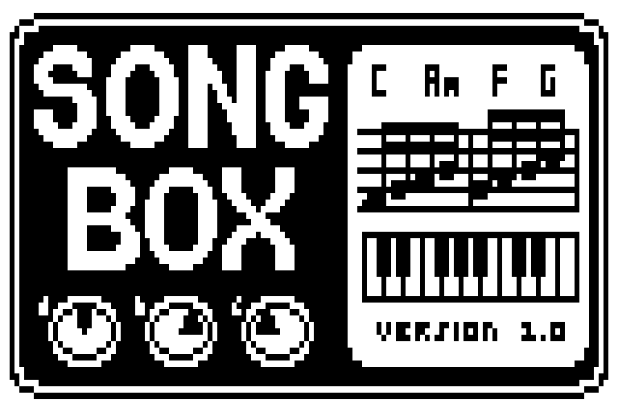

# SongBox — chord song sequencer ZDL for Zoom pedals



SongBox plays a chord song with bass and chords (electric piano or organ)
along with your guitar. You write the song on the pedal, bar by bar, and it can drive
DrumBox in the same patch, so the drums follow the song.

- **Songs of up to 128 bars,** each with a chord and one of 3 rhythms.
- **Chords:** the 24 major and minor chords (sharp names), Drums (only the
  drums play the bar's rhythm), Rest (silent bar) and END (marks the
  song's end).
- **3 rhythms per song** ("Rhy1" to "Rhy3"), each set to one of 149 patterns
  (bass line + chord rhythm + the DrumBox beat and fills that go with it)
  or to Randm (a random pattern for each run of bars with that rhythm,
  picked again every time the song comes to it). Bass and chords swing with the pattern's
  DrumBox beat.
- **Saved in the patch** through [Floppy](../floppy/README.md), a storage
  effect in another slot of the same patch. One Floppy holds 106 bits
  (repeated bars and sections cost little); up to 4 copies hold longer
  songs (102 bits more each). Without Floppy the song is not saved.
- **Drives DrumBox:** with [DrumBox](../drumbox/README.md) in the same
  patch, SongBox sets its beat, fills and tempo for each bar and starts and
  stops it with the song (MS pedals untested). After a patch change both
  start with 2 count-in bars while DrumBox loads its sounds.
- **Tempo 40–250 BPM.** Three instrument sets (electric piano, jazz organ,
  rock organ), each as bass + chords, bass only or chords only, or muted
  (DrumBox keeps following).
- **Song settings** (MENU): play once or in a loop, chords an octave up or
  down, a chord every bar, half bar or beat.
- **Footswitch on:** the song plays from bar 1. **Off:** it stops.
- The guitar passes through at full level, mixed with the instruments.

Version 0.7 (beta). Status: works on the B1Xon 1.30 (G1on family). Untested on the MS pedals
(MS-70CDR 2.10, MS-50G 3.10, MS-60B 2.10; their addresses are read from
the firmware, not tried): saving and DrumBox control assume the same patch
layout as on the G1on. The MS-60B has 4 slots per patch.

## Install

`SONGBOX.ZDL` (32,635 B) needs 8 free flash blocks; `FLOPPY.ZDL` 1 more.
It is in the **SFX** category (gid 7, fxid 521). Install both as described
in the [main README](../../README.md#install), then put SongBox, Floppy
and (optionally) DrumBox into one patch.

## Controls

| Page | Knob | Values | Meaning |
|---|---|---|---|
| 1 | Bar | MENU, 1–128, STATUS | Bar to edit; MENU and STATUS see below |
| 1 | Chord | END, C–B, Cm–Bm, Drums, Rest | The bar's chord |
| 1 | Rhythm | Rhy1, Rhy2, Rhy3 | The bar's rhythm |
| 2 | Rhy1 | Randm, 149 patterns ([Patterns](#patterns)) | Pattern played by rhythm 1 |
| 2 | Rhy2 | as Rhy1 | Pattern played by rhythm 2 |
| 2 | Rhy3 | as Rhy1 | Pattern played by rhythm 3 |
| 3 | Tempo | 40–250 | Tempo in BPM |
| 3 | Volume | 0–100 | Instrument level (50 = unchanged) |
| 3 | Instr | EPiano, EP Bs, EP Ch, JzzOrg, Jaz Bs, Jaz Ch, RckOrg, Rck Bs, Rck Ch, Mute | Instrument set and which parts play |

### Writing a song

1. Turn "Bar" to 1 and pick its "Chord" and "Rhythm".
2. Turn "Bar" one step further: the bar after the song's end shows END.
   - Turn "Chord" there: a new bar with that chord is added.
   - Turn "Rhythm" there: the last bar is copied with that rhythm.
3. Repeat. Bars are added one at a time; "Bar" can't go past STATUS.
4. To end the song early, set a bar's chord to END. Bars after it stay in
   memory until MENU → TRIM removes them, but only the bars before it play
   and are saved.

### MENU (Bar = MENU)

"Chord" picks the option; the knob names spell its question and "Rhythm"
gives the answer. OCTAVE and LENGTH are saved with the song; on a patch
change PLAY goes back to LOOP and OCTAVE / LENGTH to the saved values.

| Option | Question | Values |
|---|---|---|
| PLAY | Select play mode: | OFF, ONCE (stop after the last bar), LOOP (default). Not saved: LOOP again after a reload |
| OCTAVE | Shift chords by: | -1, 0 (default), +1: the chords one octave down / up (the bass stays) |
| LENGTH | Change chord every: | BAR (default), HALF, BEAT: how long each song bar plays, for songs that change chords within a bar (still 4/4, not a time signature). Rhythms and DrumBox still run in whole bars: each drum bar plays the rhythm of its first song bar (a Rest there silences the drums for the whole bar; use Drums to keep them); a song that ends inside one rests up to its end |
| TRIM | Trim after END? | NO, YES: after a 5 s countdown ("YES 5" … "YES 1") removes the first END and every bar after it, then shows DONE |
| CLEAR | Clear the song? | NO, YES: after a 5 s countdown empties the song, then shows DONE |

### STATUS (the position after the last bar)

Read only. The knob names show the song's size in bits, used / capacity,
and the playing bar ("Size:" "55/106" "B: 12"; "Pack" while saving).
Without Floppy the first two take turns, about 1.5 s each: "Size: 55/0", "Can't save!", "(no  floppy)". The values
show the playing chord and, after an arrow, the next one ("STATUS" "Am"
"→  G").

### Messages

- **Full:** the edit doesn't fit into the Floppy copies present; the
  knobs jump back. Add another Floppy or shorten the song.
- **Flop?:** the song needs a Floppy copy that is missing; only CLEAR works
  until it is back.
- **Err:** the packed song failed to decode back to the edit three times;
  the edit is refused (please report it).

## Patterns

Each pattern is named after the DrumBox beat it plays (one for nearly
every DrumBox style beat); a few variations play an existing beat with their own bass
and chords (RkArp, Bald2, Funk3, Disc2, Bssa2, Blue2, and the arpeggios
Arp8, Arp16, ArpSw). Defaults:
Rhy1 Rock, Rhy2 Funk, Rhy3 Balld. Randm (knob value 0) picks any pattern. Notes are relative to each bar's chord: besides the
triad, the bass can play the 3rd, 6th, 2nd and an approach note into the
next chord, the keys sus4 / sus2 and the 9th, each only where it fits the
song's key; the keys also play chords in root position, 1st or 2nd
inversion or wide (root, 5th, 10th), and arpeggios of root, fifth, octave
and 10th over 1.3 octaves (letters in `patterns/song_patterns.py`). Swing comes from the
DrumBox beat: `sw16` = light 16th swing, `tri8` = 8th-note shuffle; bass
and chords swing with it.

| Knob | Screen | Pattern | Swing |
|---|---|---|---|
| 0 | Randm | Random (a pattern for each run of bars with this rhythm, picked again every time the song comes to it) |  |
| 1 | Rock | Rock |  |
| 2 | Rock2 | Rock 2 |  |
| 3 | Rock3 | Rock 3 |  |
| 4 | Rock4 | Rock 4 |  |
| 5 | RkArp | Rock Arpeggio |  |
| 6 | Arp8 | Arpeggio 8ths |  |
| 7 | Arp16 | Arpeggio 16ths |  |
| 8 | Rk16 | Rock 16ths |  |
| 9 | Rk16b | Rock 16ths 2 |  |
| 10 | SyncR | Syncopated Rock |  |
| 11 | 4Flr | Four-Floor Rock |  |
| 12 | Drive | Driving 8ths |  |
| 13 | HRock | Hard Rock |  |
| 14 | HRk2 | Hard Rock 2 |  |
| 15 | RRock | Ride Rock |  |
| 16 | RdFlr | Ride Floor |  |
| 17 | OHRk | Open-Hat Rock |  |
| 18 | Balld | Ballad |  |
| 19 | Bald2 | Ballad 2 |  |
| 20 | SlowR | Slow Rock |  |
| 21 | RdBal | Ride Ballad |  |
| 22 | PwrBd | Power Ballad |  |
| 23 | Pop2 | Pop 2 |  |
| 24 | Pop3 | Pop 3 |  |
| 25 | PopRk | Pop Rock |  |
| 26 | PopR2 | Pop Rock 2 |  |
| 27 | PwrPp | Power Pop |  |
| 28 | PBald | Pop Ballad |  |
| 29 | Pop16 | Pop 16ths |  |
| 30 | PSw16 | Pop 16ths Swing | sw16 |
| 31 | PShuf | Pop Shuffle | tri8 |
| 32 | DncPp | Dance Pop |  |
| 33 | Motwn | Motown |  |
| 34 | SoftR | Soft Rock |  |
| 35 | FolkR | Folk Rock |  |
| 36 | FStmp | Folk Stomp |  |
| 37 | ClRk | Classic Rock |  |
| 38 | 80sRk | 80s Rock |  |
| 39 | South | Southern Rock |  |
| 40 | Indie | Indie Rock |  |
| 41 | AltRk | Alt Rock |  |
| 42 | Garag | Garage Rock |  |
| 43 | Glam | Glam Stomp |  |
| 44 | Stomp | Stadium Stomp |  |
| 45 | HTRk | Half-Time Rock |  |
| 46 | HTShf | Half-Time Shuffle | tri8 |
| 47 | FastR | Fast Rock |  |
| 48 | Prog | Prog Rock |  |
| 49 | Punk | Punk |  |
| 50 | DBeat | D-Beat |  |
| 51 | PopPk | Pop Punk |  |
| 52 | HCore | Hardcore |  |
| 53 | PostP | Post-Punk |  |
| 54 | NWave | New Wave |  |
| 55 | Grung | Grunge |  |
| 56 | Shufl | Shuffle | tri8 |
| 57 | Boogi | Boogie | tri8 |
| 58 | Rkbly | Rockabilly | tri8 |
| 59 | Surf | Surf Toms |  |
| 60 | BoDid | Bo Diddley |  |
| 61 | TomGr | Tom Groove |  |
| 62 | FlTom | Floor Tom Rock |  |
| 63 | FlHat | Floor Tom + Hats |  |
| 64 | Train | Train Beat |  |
| 65 | TrSwg | Train Swing | sw16 |
| 66 | Motor | Motorik |  |
| 67 | Metal | Metal |  |
| 68 | Thrsh | Thrash |  |
| 69 | Blast | Blast Beat |  |
| 70 | Galop | Gallop |  |
| 71 | Djent | Djent |  |
| 72 | HTMtl | Half-Time Metal |  |
| 73 | Brkdn | Breakdown |  |
| 74 | Funk | Funk |  |
| 75 | SwFnk | Swung Funk | sw16 |
| 76 | Funk2 | Funk 2 |  |
| 77 | Funk3 | Funk 3 |  |
| 78 | FDrum | Funky Drummer |  |
| 79 | Strut | Strut |  |
| 80 | GoGo | Go-Go |  |
| 81 | NOLA | New Orleans |  |
| 82 | Purdy | Purdie Shuffle | tri8 |
| 83 | LinFk | Linear Funk |  |
| 84 | Disco | Disco |  |
| 85 | Disc2 | Disco 2 |  |
| 86 | DeepH | Deep House |  |
| 87 | SwHse | Swing House | sw16 |
| 88 | Minml | Minimal |  |
| 89 | Techn | Techno |  |
| 90 | Break | Breakbeat |  |
| 91 | Amen | Amen |  |
| 92 | Think | Think Break |  |
| 93 | Apach | Apache |  |
| 94 | Impch | Impeach |  |
| 95 | Levee | Levee Break |  |
| 96 | CSwet | Cold Sweat |  |
| 97 | RollB | Rolling Break |  |
| 98 | BrkB2 | Breakbeat 2 |  |
| 99 | HHBrk | Hip-Hop Break |  |
| 100 | BrkRd | Breakbeat Ride |  |
| 101 | NuSkl | Nu Skool Breaks |  |
| 102 | HTBrk | Half-Time Break |  |
| 103 | BigB1 | Big Beat |  |
| 104 | BigB2 | Big Beat 2 |  |
| 105 | BBShf | Big Beat Shuffle | sw16h |
| 106 | BBTom | Big Beat Toms |  |
| 107 | DnB | Drum and Bass |  |
| 108 | Jungl | Jungle |  |
| 109 | Dubst | Dubstep |  |
| 110 | 2Step | 2-Step Garage |  |
| 111 | BBap | Boom Bap |  |
| 112 | BBap2 | Boom Bap 2 |  |
| 113 | BBpSw | Boom Bap Swing | sw16 |
| 114 | LoFi | Lo-Fi |  |
| 115 | LoFiS | Lo-Fi Swing | sw16 |
| 116 | Half | Half Time |  |
| 117 | Drill | Drill |  |
| 118 | Trap | Trap |  |
| 119 | NJack | New Jack Swing |  |
| 120 | NeoSl | Neo Soul |  |
| 121 | Dilla | Dilla | sw16h |
| 122 | Songo | Songo |  |
| 123 | Bolro | Bolero |  |
| 124 | Cumbi | Cumbia |  |
| 125 | Rgtn | Reggaeton |  |
| 126 | Baiao | Baiao |  |
| 127 | Tango | Tango |  |
| 128 | Calyp | Calypso |  |
| 129 | Samba | Samba |  |
| 130 | Bossa | Bossa Nova |  |
| 131 | Bssa2 | Bossa Nova 2 |  |
| 132 | 1Drop | One Drop |  |
| 133 | Rckrs | Rockers |  |
| 134 | Stepr | Steppers |  |
| 135 | Ska | Ska |  |
| 136 | Dub | Dub |  |
| 137 | Swing | Swing | tri8 |
| 138 | Bebop | Bebop | tri8 |
| 139 | Jazz4 | Jazz 4 | tri8 |
| 140 | Texas | Texas Shuffle | tri8 |
| 141 | Blues | Blues | tri8 |
| 142 | Blue2 | Blues 2 | tri8 |
| 143 | ArpSw | Arpeggio Swing | tri8 |
| 144 | Cntry | Country |  |
| 145 | CnShf | Country Shuffle | tri8 |
| 146 | March | March |  |
| 147 | Afro | Afrobeat |  |
| 148 | Bhang | Bhangra |  |
| 149 | Maqsm | Maqsum |  |

## How it works

- **Storage:** the song is packed into a bit stream (key + 3-bit tokens:
  OCTAVE and LENGTH, 3 bits (6 for LOW or HIGH with BEAT), then chord
  degrees, rhythm changes, repeats, section copies) and written to
  Floppy's knob fields through [zmenu](../common/zmenu/README.md) stream mode.
  The packer runs a few steps per audio call and checks that the stream
  decodes back to the song before writing it.
- **Sound:** bass and chords from one of three instrument sets, mono,
  added to the guitar. Each instrument plays one wavetable, built in
  `ctx[3]` a little per audio call after loading or a patch change.
- **DrumBox:** SongBox writes DrumBox's knob values for each bar; DrumBox
  (follow mode) copies them every call. With shorter song bars (MENU
  LENGTH) a DrumBox bar takes the beat of its first chord bar.
- **State** lives in the effect's `ctx[3]` memory.

## Files

| File | Purpose |
|---|---|
| `songbox.c` | Audio function `Fx_SFX_SongBox`: editor, packer, player, DrumBox control |
| `build.py` | Generates the headers, runs `cl6x`, then the linker |
| `instruments/` | `engine.c` (the one instrument engine: a wavetable voice driven by a record, `SsInst` in `engine.h`) and its Python mirror `engine.py`; one `<id>.py` per instrument with its record and wavetable harmonics: `epiano`, `organ_jazz`, `organ_rock`; `inst_lib.h` C helper |
| `inst_lib.py` | Helpers shared by the instrument models (sine, decay coefficients, voice) |
| `sets.py` | Instrument sets (one keys + one bass instrument each) and the Instr knob values → `songbox_instr.h` |
| `proto.py` | Patterns and note increments → `songbox_sound.h`; renders WAV prototypes of each set |
| `patterns/patterns.json` | The 149 patterns: bass, chords and DrumBox beat / fills (format in `song_patterns.py`) |
| `patterns/song_patterns.py` | Reads and checks `patterns.json` |
| `packer/songseq.py` | Reference model of the song stream format (packer + unpacker) |
| `packer/songpack.py` | The same, written the way the C does it (fixed arrays, integers, steps) |
| `packer/songpack.h` | Line-by-line C copy of `songpack.py`, included by `songbox.c` |
| `packer/songpack_vectors.txt` | Test vectors for the packer |
| `screen.png` | The 128x64 screen image |

Generated (edit their sources, not them): `songbox_sound.h` (`proto.py`),
`songbox_instr.h` (`sets.py` + `instruments/`),
`songbox_drums.h` (DrumBox's `patterns.py` + `patterns.json`),
`songbox_tests.h` (`songpack.py`, not used by the current build).

## Build

Needs the TI C6000 Code Generation Tools (see the
[DrumBox README](../drumbox/README.md#build)), `../common/zmenu/` and
`../drumbox/patterns/`.

```
python -B build.py --out PATH          # SONGBOX.ZDL to PATH
python -B build.py --probe --out PATH  # with the CPU load meter in STATUS (development)
python -B build.py --tests             # only regenerate songbox_tests.h (no TI needed)
python -B proto.py [--set epiano]      # instrument set prototypes -> preview/*.wav
```

After building check: `.fardata: 4 bytes`, the `.obj` relocations each
with a `.rela.dyn` entry, and the allocated size under ~29,968 B.

## Known limitations

- **MS pedals untested** (MS-70CDR 2.10, MS-50G 3.10, MS-60B 2.10): song
  storage and DrumBox control assume the G1on patch layout.
- **Mono instruments.**
- **One SongBox per patch:** a second copy stays silent (the first in the
  chain plays).
- More than one Floppy copy is untested.
